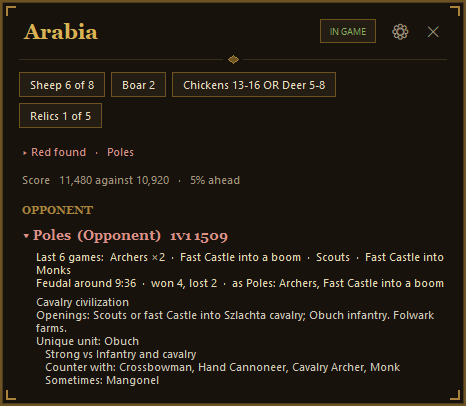
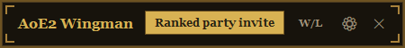
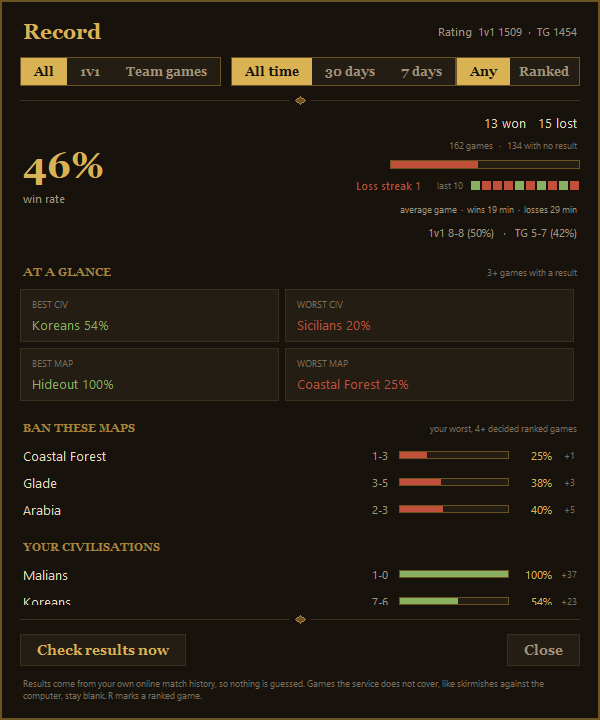
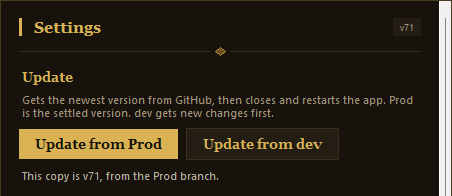

# AoE2 Wingman

A small helper box that sits on top of **Age of Empires II: Definitive Edition** while you play ranked.

It tells you about the map, sizes up your opponent, and gives you a nudge when you forget something.

*90,000 lines that I didn't read. But it's amazing.*

## What it does

- **Knows the map.** Shows the sheep, boar and relics on the map, and counts them off as you find them.
- **Sizes up your opponent.** Their civ, their rating, how they started their last few games, and what beats their special unit.
- **Spots the enemy.** Says the colour out loud ("Red found") the first time they show up on your minimap.
- **Nags you, nicely.** A red flash when your Town Center stops making villagers. A blue one when you need a house. A reminder at 15 minutes to get ready for Castle Age.
- **Tells you when the game looks lost.** If you fall a long way behind on score, it lets you know. It never quits for you.
- **Keeps your record.** Wins and losses by civ and by map, and which maps you should ban.
- **Rounds up your mates.** One button invites your friends to a ranked party, and can post the invite in Discord.
- **Pulls you back to the game.** If you're in another window when the match starts, it switches you over.

### Is it cheating?

No. It only uses things you can already see: the lobby, your own screen, and the public ladder. It never looks inside the game.

## How to install

You need a Windows PC with Age of Empires II: Definitive Edition. It takes about five minutes.

**1. Get Python**

Python is the free program Wingman runs on.

- Go to [python.org/downloads](https://www.python.org/downloads/) and click the big yellow download button.
- Open the file you downloaded.
- **Tick the box that says "Add python.exe to PATH"** at the bottom of the first screen. Don't skip this one.
- Click **Install Now**.

**2. Download Wingman**

- At the top of this page, click the green **Code** button, then **Download ZIP**.
- Open the ZIP and drag the folder inside it onto your Desktop.

**3. Start it**

- Open the folder and double-click **AoE2 Wingman.bat**.
- A small bar shows up in the corner of your screen. That's it running.

The first time, give it a minute. It grabs a few extra bits it needs by itself.

If Windows shows a blue "Windows protected your PC" box, click **More info**, then **Run anyway**.

**4. Add the God Mode mod**

The Town Center alert needs this mod to work.

- Click the cog on the Wingman bar.
- Scroll down to **God Mode mod** and click **Open its mod page**.
- Subscribe to the mod, then switch it on in the game under **Mods**.

**5. Play**

Start a ranked game. The bar opens up into the full panel by itself when the match begins.

## How to use it

- **Move it:** drag it anywhere on your screen.
- **Shrink it:** click the map name to roll it up. Click again to open it.
- **Tips on your opponent:** click their name.
- **Your record:** click **W/L** on the bar (between games).
- **Settings:** click the cog.
- **Close it:** click the cross.

## How to update

Click the cog, then **Update from Prod**. It gets the newest version and restarts.

If it says it could not download, just download the ZIP again (step 2) and swap the old file for the new one.

Your settings and your record are saved separately, so you won't lose them.

**Update from dev** gets the very latest changes before they have been tested much. Stick with Prod unless you like surprises.

## Not working?

- **Nothing happens when I double-click it.** Python is missing, or the "Add python.exe to PATH" box was not ticked. Install Python again and tick the box.
- **No Town Center alert.** The God Mode mod is not switched on. Check the game's **Mods** menu.
- **No "Red found" voice or animal count.** Give it a minute on your first game. It sets itself up the first time.

## Extras

Both of these are in Settings:

- **Loading screen cheat sheet.** A quick reminder about your civ and theirs while the game loads. It is off until you switch it on.
- **Mod clash check.** Finds mods that are getting in each other's way.
