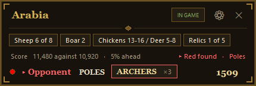

# AoE2 Wingman

A small helper box that sits on top of **Age of Empires II: Definitive Edition** while you play ranked. It tells you about the map, sizes up your opponent, walks you through a build order and nudges you when you forget something.

## Install (2 minutes)

You need a Windows PC with Age of Empires II: Definitive Edition.

1. Go to the [**download page**](https://ashley-pettit.github.io/aoe2-wingman/), or this repo's [**Releases**](https://github.com/Ashley-Pettit/aoe2-wingman/releases/latest).
2. Download **Wingman.exe** and put it somewhere easy, like your Desktop.
3. Double-click it. A small Wingman bar shows up in the corner of your screen.
4. If Windows shows a blue "Windows protected your PC" box, click **More info**, then **Run anyway**. It shows that because the exe isn't signed.
5. Start a ranked game. The bar opens into the full panel by itself when the match begins.

That's it. Wingman tells you on its bar when a new version is out, and one click updates it.

**Optional, for the idle Town Center alert:** click the cog on the bar, scroll to **God Mode mod**, open its mod page, press **Subscribe**, then switch it on in the game under **Mods**.

<b>Rather run the .bat?</b> (needs Python, updates from GitHub)

Same Wingman, just run by Python instead of packed into an exe. Handy if you like the newest bits from the dev branch.

1. Get Python from [python.org/downloads](https://www.python.org/downloads/). On the first install screen, **tick "Add python.exe to PATH"**, then click **Install Now**.
2. Download **AoE2 Wingman.bat** from [Releases](https://github.com/Ashley-Pettit/aoe2-wingman/releases/latest).
3. Double-click it. The first start takes a minute while it grabs a few extra bits.

To update: cog, then **Update from Prod** (tested) or **Update from dev** (newest, less tested).

## What it does

- **Knows the map.** Shows the sheep, boar and relics on the map, and counts them off as you find them.
- **Sizes up your opponent.** Their civ, rating, how they opened their last few games, when they usually hit Feudal and Castle, and what beats their special unit.
- **Walks you through a build order.** One step at a time, following your pop counter (see [Build orders](#build-orders) below).
- **Spots the enemy.** Says the colour out loud ("Red found") the first time they show up on your minimap.
- **Nags you, nicely.** A red flash when your Town Center stops making villagers, a blue one when you need a house, and reminders for your Feudal and Castle Age buildings.
- **Tells you when the game looks lost.** If you fall a long way behind on score, it lets you know. It never quits for you.
- **Keeps your record.** Wins and losses by civ and map, your rating game by game, and which maps to ban.
- **Rounds up your mates.** One button invites your friends to a ranked party and can post the invite in Discord.
- **Go Live.** One button pauses, says "Sorry 1 sec" in chat, shares the game in your Discord call, comes back and says "Thanks 14?".

## How to use it

- **Move it:** drag it anywhere.
- **Pick a build order:** click the build strip (or the small build button at the top if you closed it).
- **Move the build on yourself:** click the step.
- **Shrink it:** click the map name to roll it up. Click again to open it.
- **Fold your opponent away:** click their name.
- **Your record:** click **W/L** on the bar (between games).
- **Settings:** click the cog.
- **Close it:** click the cross.

## Build orders

From **Hera's strategy guide** (December 2025 edition), cut down to one line per step so you can read them mid game. All credit for the builds goes to Hera.

**How to read them:** "Pop" is the population counter at the top of your screen: villagers plus your scout (plus any militia). Your three starting villagers are pop 2 to 4. Each line tells you what to do with the villager that just came out at that pop. The "click Feudal" line lands on the last villager, because the Town Center stops making villagers while it researches. Your civ, map and start will shift the numbers a little, so treat these as the shape, not a script.

#### Scouts

<b>Scouts, one stable</b> · 19 pop, Feudal 8:50

| Pop | Do this |
|---|---|
| 2 to 7 | 6 to sheep under the TC |
| 8 to 9 | 2 to wood |
| 10 | Lure the first boar |
| 11 | House, then berries with the mill |
| 12 to 17 | 6 hunt under the TC, one takes the second boar |
| 18 | 2 to wood. Lure deer with the scout |
| 19 | Second one to wood. Loom, then click Feudal (up at 8:50) |
| 20+ | Barracks then stable, 3 scouts, double bit axe |

<b>Scouts, two stables</b> · 19 pop, Feudal 8:50

| Pop | Do this |
|---|---|
| 2 to 7 | 6 to sheep under the TC |
| 8 to 9 | 2 to wood |
| 10 | Lure the first boar |
| 11 | House, then berries with the mill |
| 12 to 17 | 6 hunt under the TC. Lure deer with the scout |
| 18 | 2 to wood |
| 19 | Second one to wood. Loom, then click Feudal (up at 8:50) |
| 20+ | Barracks, then two stables, double bit axe |

<b>Scouts into archers</b> · 19 pop, Feudal 8:50

| Pop | Do this |
|---|---|
| 2 to 7 | 6 to sheep under the TC |
| 8 to 9 | 2 to wood |
| 10 | Lure the first boar |
| 11 | 1 hunts under the TC |
| 12 | House, then the mill |
| 13 | Lure the second boar |
| 14 to 18 | 6 hunt under the TC |
| 19 | Sixth one hunts. Loom, then click Feudal (up at 8:50) |
| 20+ | 6 to wood until 8 on one camp, 4 berries, barracks, double bit axe |

<b>Scouts into skirms</b> · 19 pop, Feudal 8:50

| Pop | Do this |
|---|---|
| 2 to 7 | 6 to sheep under the TC |
| 8 to 9 | 2 to wood |
| 10 | Lure the first boar |
| 11 | 1 hunts under the TC |
| 12 | House, then berries with the mill |
| 13 | Lure the second boar |
| 14 to 18 | 6 hunt under the TC. Lure deer with the scout |
| 19 | Sixth one hunts. Loom, then click Feudal (up at 8:50) |
| 20+ | 6 to wood until 8 on one camp, 4 berries, barracks and house |

#### Archers

<b>Archers, one range</b> · 20 pop, Feudal 9:15

| Pop | Do this |
|---|---|
| 2 to 7 | 6 to sheep under the TC |
| 8 to 10 | 3 to wood |
| 11 | Lure the first boar |
| 12 | House, then berries with the mill |
| 13 to 18 | 6 hunt under the TC, one takes the second boar |
| 19 | 2 to wood. Lure deer with the scout |
| 20 | Second one to wood. Loom, then click Feudal (up at 9:15) |
| 21+ | 5 hunt to a second lumber camp, 2 berries, 3 gold, range up |

#### Infantry

<b>Men-at-arms</b> · 19 pop, Feudal 8:50

| Pop | Do this |
|---|---|
| 2 to 7 | 6 to sheep under the TC |
| 8 to 10 | 3 to wood, one builds a house in the wall |
| 11 | Lure the first boar. Lure 2 deer, not optional |
| 12 to 16 | 5 hunt under the TC, take the second boar |
| 17 | Barracks, then a house at the front. No mill yet |
| 18 | 2 more hunt |
| 19 | Second one hunts. Loom, then click Feudal (up at 8:50) |
| 20+ | 5 hunt to wood, 2 gold camp, 1 berries, 3 militia out |

<b>Men-at-arms into skirms</b> · 20 pop, Feudal 9:15

| Pop | Do this |
|---|---|
| 2 to 7 | 6 to sheep under the TC |
| 8 to 10 | 3 to wood |
| 11 | Lure the first boar |
| 12 | House, then the mill on chickens, or berries |
| 13 to 14 | 2 more to the mill. Lure a deer or two if you can |
| 15 | Lure the second boar |
| 16 to 17 | 2 hunt under the TC |
| 18 | Barracks, then a house at the front |
| 19 | 2 more hunt |
| 20 | Second one hunts. Loom, then click Feudal (up at 9:15) |
| 21+ | Militia out, skirms behind them |

<b>Feudal drush</b> · 19 pop, Feudal 8:50

| Pop | Do this |
|---|---|
| 2 to 7 | 6 to sheep under the TC |
| 8 to 10 | 3 to wood |
| 11 | Lure the first boar |
| 12 | House, then back to the hunt |
| 13 to 16 | 4 hunt under the TC, take the second boar |
| 17 | Barracks out front, house beside it. No mill yet |
| 18 | 1 more hunt |
| 19 | 1 to wood. Loom, then click Feudal (up at 8:50) |
| 20+ | Militia out, 1 to berries with the mill |

<b>Double barracks eagles</b> · 19 pop, Feudal 8:50

| Pop | Do this |
|---|---|
| 2 to 7 | 6 to sheep under the TC |
| 8 to 9 | 2 to wood |
| 10 | Lure the first boar |
| 11 | 1 hunts under the TC |
| 12 | House, then the mill |
| 13 | Lure the second boar |
| 14 to 18 | 6 hunt under the TC. Lure deer with the scout |
| 19 | Sixth one hunts. Loom if Aztecs or Incas, then click Feudal (up at 8:50) |
| 20+ | 5 to wood for 7 on one camp, 2 gold, barracks and house, 3 berries |

#### Fast Castle

<b>Fast Castle boom</b> · 24 pop, Castle 14:00

| Pop | Do this |
|---|---|
| 2 to 7 | 6 to sheep under the TC |
| 8 to 10 | 3 to wood |
| 11 | Lure the first boar |
| 12 | House, then berries with the mill |
| 13 to 14 | 2 hunt, one takes the second boar. Lure 3 deer |
| 15 to 18 | 4 to berries, seed 3 farms off the hunt |
| 19 to 22 | 4 to wood |
| 23 | 2 to gold |
| 24 | Second one to gold. Click Feudal, no loom (up at 10:30) |
| 25 to 26 | Feudal is in: 2 more to wood, market and blacksmith |
| 27+ | Click Castle as soon as both are up (in at 14:00) |

<b>Drush into Fast Castle</b> · 31 pop, Castle 16:05

| Pop | Do this |
|---|---|
| 2 to 7 | 6 to sheep under the TC |
| 8 to 11 | 4 to wood |
| 12 | Lure the first boar |
| 13 | 2 houses, then a barracks |
| 14 to 17 | 1 to gold, then back to the boar. 3 militia out |
| 18 | Lure the second boar |
| 19 to 23 | 5 to berries, build the mill |
| 24 to 27 | 4 to wood on one camp, then loom |
| 28 to 30 | 4 to gold |
| 31 | Fourth one to gold. Click Feudal (up at 12:35) |
| 32 to 33 | Feudal is in: 2 more to gold, range and blacksmith |
| 34+ | Click Castle, keep the militia busy (in at 16:05) |

<b>Knight rush (easier)</b> · 26 pop, Castle 16:05

| Pop | Do this |
|---|---|
| 2 to 7 | 2 houses first, then 6 to sheep |
| 8 to 10 | 3 to wood |
| 11 | Lure the first boar |
| 12 | 2 houses, then berries with the mill |
| 13 | 1 hunts under the TC |
| 14 | Lure the second boar |
| 15 to 18 | 4 to berries |
| 19 to 23 | 5 to wood |
| 24 to 25 | A house, then 3 to gold |
| 26 | Third one to gold. Loom, then click Feudal (up at 11:45). Barracks and a house |
| 27+ | Stable and market, 4 more to gold, click Castle (in at 16:05) |

#### Other

<b>Tower rush, any civ</b> · 18 pop, Feudal 8:25

| Pop | Do this |
|---|---|
| 2 to 7 | 6 to sheep under the TC |
| 8 to 9 | 2 to wood |
| 10 | Lure the first boar |
| 11 | 1 hunts under the TC |
| 12 | House, then the mill |
| 13 | Lure the second boar |
| 14 to 17 | 5 hunt under the TC |
| 18 | Fifth one hunts. Loom, scout them, then click Feudal (up at 8:25) |
| 19+ | 2 to stone with a camp, 5 forward, spears or skirms behind the towers |

<b>Teuton tower rush</b> · 18 pop, Feudal 8:25

| Pop | Do this |
|---|---|
| 2 to 7 | 6 to sheep under the TC |
| 8 to 9 | 2 to wood |
| 10 | Lure the first boar |
| 11 | 1 hunts under the TC |
| 12 | House, then the mill |
| 13 | Lure the second boar |
| 14 to 17 | 5 hunt under the TC |
| 18 | Fifth one hunts. Loom, scout them, then click Feudal (up at 8:25) |
| 19+ | 2 to stone with a camp, 10 forward, tower 8 tiles off their wood |

## Is it cheating?

No. It only uses things you can already see: the lobby, your own screen and the public ladder. It never looks inside the game, never gives you information you don't already have, and never moves your units.

## Not working?

- **Windows blocks the exe.** Click **More info**, then **Run anyway**. Some antivirus programs get nervous too, because it reads your screen and presses keys for the party invite and Go Live.
- **The .bat does nothing when double-clicked.** Python is missing, or "Add python.exe to PATH" wasn't ticked. Install Python again and tick the box.
- **No Town Center alert.** The God Mode mod isn't switched on. Check the game's **Mods** menu.
- **The party invite says the game runs as administrator.** Windows won't let a normal program click a game running as admin. Click **Fix it** to stop the game (or Steam) needing admin, then restart Steam. In a hurry? Click **Restart Wingman as admin**.
- **No "Red found" voice or animal count.** Give it a minute on your first game. It sets itself up the first time.

## Extras

Both are in Settings:

- **Loading screen cheat sheet.** A quick reminder about your civ and theirs while the game loads. Off until you switch it on.
- **Mod clash check.** Finds mods that are getting in each other's way.

Your settings and record are saved separately from the app, so updating never loses them.
